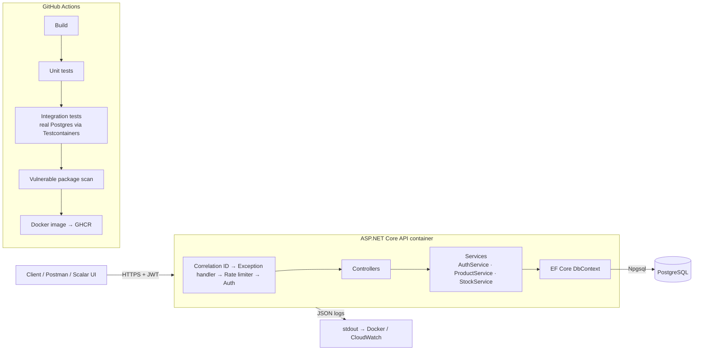

# StockTrack API

A backend for tracking retail stock: products, stock coming in and going out, and low-stock alerts.
Built with **C# / ASP.NET Core 10**, **PostgreSQL** and **Entity Framework Core**, secured with **JWT**,
tested with **xUnit + Testcontainers**, packaged with **Docker** and built by **GitHub Actions**.

## Architecture



| Layer | What it does |
|---|---|
| `Controllers/` | HTTP endpoints, request validation (data annotations), authorisation attributes |
| `Services/` | Business rules: no negative stock, movement direction rules, opening-stock history, paging |
| `Auth/` | Password hashing (PBKDF2 via ASP.NET Identity), JWT creation, admin-only policy |
| `Data/` | EF Core model, migrations, startup migration + admin seeding |
| `Errors/` | Maps exceptions to RFC 7807 problem responses; never leaks stack traces |
| `Infrastructure/` | Correlation-id middleware for tracing a request through the logs |

## Endpoints

| Method | Path | Who |
|---|---|---|
| POST | `/api/auth/login` | anyone (rate limited 5/min per IP) |
| POST | `/api/auth/users` | Admin |
| GET | `/api/products?category=&lowStock=&page=&pageSize=` | Staff, Admin |
| GET | `/api/products/{id}` | Staff, Admin |
| POST / PUT / DELETE | `/api/products[/{id}]` | Admin |
| POST | `/api/products/{id}/movements` | Staff, Admin |
| GET | `/api/products/{id}/movements` | Staff, Admin |
| GET | `/health` | anyone (checks the database) |

Interactive API docs (Scalar) are at `/scalar` when running in Development.

## Running it

### With Docker (easiest)

```bash
cp .env.example .env        # then put real random values in .env
docker compose up -d --build
curl localhost:8080/health
```

### From source

```bash
docker compose up -d db                                   # just the database
dotnet user-secrets set "Jwt:SigningKey" "$(openssl rand -base64 48)" --project src/StockTrack.Api
dotnet user-secrets set "Seed:AdminPassword" "a-long-local-password" --project src/StockTrack.Api
dotnet user-secrets set "Seed:AdminEmail" "admin@stocktrack.local" --project src/StockTrack.Api
dotnet run --project src/StockTrack.Api
```

### Tests

```bash
dotnet test                                    # unit + integration (integration needs Docker running)
dotnet test tests/StockTrack.UnitTests         # unit only
```

## Security and privacy decisions

- **No secrets in the repo.** The JWT key, DB password and admin password come from environment variables,
  `.env` (git-ignored) or `dotnet user-secrets`. The app refuses to start if the JWT key is missing or under 32 chars.
- **Minimal personal data.** Users are an email, a password hash and a role, nothing else. Tokens contain
  only a user id and role, not the email, because JWTs are readable by anyone who has one.
- **Passwords** are hashed with PBKDF2 (ASP.NET Identity `PasswordHasher`), and login responses don't reveal
  whether the email or the password was wrong.
- **Least privilege.** Staff can record stock movements; only admins can manage products and users. There's no public sign-up.
- **Brute-force protection** via a per-IP rate limit on login.
- **Container** runs as a non-root user, and the runtime image contains no SDK or source.
- **Audit trail.** Every stock change is stored with who did it and when, and the quantity after the change.
- **Concurrency.** PostgreSQL `xmin` row versioning stops two simultaneous updates from silently overwriting each other (returns 409).
- **Dependencies** are scanned for known vulnerabilities in CI, and Dependabot opens update PRs weekly.

## Deployment

See [docs/aws-deployment.md](docs/aws-deployment.md).
