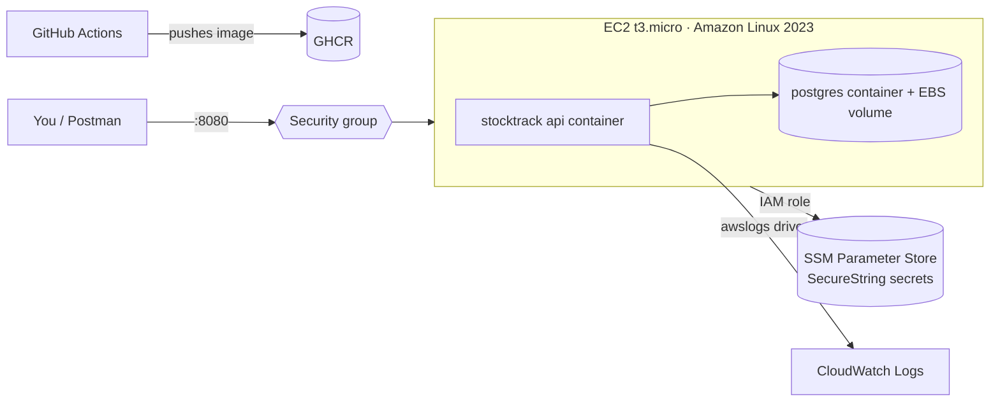

# Deploying StockTrack to AWS

This setup keeps costs at or near **$0 on the AWS Free Tier** while still using the core services the
HCLTech job asks for: IAM, EC2, VPC security groups, Systems Manager Parameter Store (secrets) and CloudWatch (logs).



> **Before you start:** create an AWS Budget alert ($1) in Billing → Budgets, so you get an email if anything starts costing money.
> When you've finished taking your evidence screenshots, **stop or terminate the instance**.

## 1. Store secrets in Parameter Store (not in files on the server)

```bash
aws ssm put-parameter --name /stocktrack/POSTGRES_PASSWORD   --type SecureString --value "$(openssl rand -hex 16)"
aws ssm put-parameter --name /stocktrack/JWT_SIGNING_KEY     --type SecureString --value "$(openssl rand -base64 48)"
aws ssm put-parameter --name /stocktrack/SEED_ADMIN_PASSWORD --type SecureString --value "$(openssl rand -hex 12)"
```

## 2. IAM role for the instance (least privilege)

Create a role for EC2 named `stocktrack-ec2-role` with:
- the AWS managed policy `CloudWatchAgentServerPolicy` (lets Docker send logs)
- the AWS managed policy `AmazonSSMManagedInstanceCore` (lets you connect with Session Manager, so no SSH port is needed)
- an inline policy that can **only** read the three parameters above:

```json
{
  "Version": "2012-10-17",
  "Statement": [{
    "Effect": "Allow",
    "Action": ["ssm:GetParameter", "ssm:GetParameters"],
    "Resource": "arn:aws:ssm:*:*:parameter/stocktrack/*"
  }]
}
```

## 3. Launch the instance

- AMI: Amazon Linux 2023, type `t3.micro` (free-tier eligible), 20 GB gp3 disk
- IAM instance profile: `stocktrack-ec2-role`
- Security group: inbound **TCP 8080 from your IP only** (no port 22: use Session Manager)

## 4. Install Docker and start the app (in a Session Manager shell)

```bash
sudo dnf install -y docker git && sudo systemctl enable --now docker
sudo mkdir -p /usr/libexec/docker/cli-plugins
sudo curl -sSL https://github.com/docker/compose/releases/latest/download/docker-compose-linux-x86_64 \
  -o /usr/libexec/docker/cli-plugins/docker-compose && sudo chmod +x /usr/libexec/docker/cli-plugins/docker-compose

git clone https://github.com/<your-username>/stocktrack-api.git && cd stocktrack-api

# Pull secrets from Parameter Store into a .env that only root can read
p() { aws ssm get-parameter --with-decryption --name "/stocktrack/$1" --query Parameter.Value --output text; }
sudo bash -c "umask 077; cat > .env" <<EOF
POSTGRES_PASSWORD=$(p POSTGRES_PASSWORD)
JWT_SIGNING_KEY=$(p JWT_SIGNING_KEY)
SEED_ADMIN_EMAIL=admin@stocktrack.local
SEED_ADMIN_PASSWORD=$(p SEED_ADMIN_PASSWORD)
EOF

sudo docker compose -f docker-compose.yml -f docker-compose.aws.yml up -d
curl localhost:8080/health
```

## 5. Check it works and collect evidence

- From your laptop: `curl http://<public-ip>:8080/health`, then log in with Postman and call the product endpoints
- CloudWatch → Log groups → `/stocktrack/api`: find the "low on stock" warning and filter by `CorrelationId`
- Screenshot: EC2 instance running, the security group rules, the IAM role and policy, the Parameter Store
  entries (values hidden), the CloudWatch log events, and Postman hitting the public IP

## 6. Clean up

Terminate the instance, delete the log group and the parameters. Keep the budget alert.
